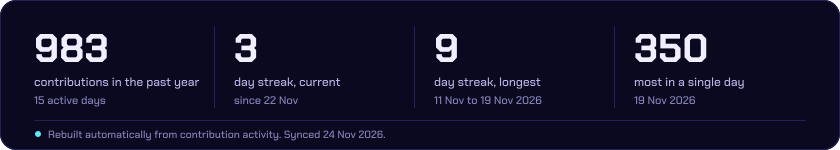

  

### Hi, I'm Vibe

I work in cyber security, mostly around threat intelligence, digital forensics and incident response, and threat hunting. When the job needs a tool that doesn't exist yet, I build it.

- **Building:** analysis platforms and small, sharp utilities for security work
- **Studying:** anything cyber security and DFIR, there is always something on the go
- **Heads up:** most of my repositories are private, so this page shows activity rather than code

  

  

The city and the numbers rebuild themselves every six hours from my contribution calendar. Only daily counts are used, never repository names.
