# README art kit

Helpers for building animated panels for a repository README: lettering drawn as outlines, glow, neon tubing, diagram boxes, moving connectors, and a looping timeline. Python standard library only.

- `themes.py`: one look per kind of project (palette, lettering, moving backdrop). Start here.
- `panels.py`: ready-made panels that take a theme: banner, typing terminal, feature tiles, divider.
- `starter.py`: a complete small example. Copy it to begin a new project's art.
- `kit.py`: the low-level helpers and `Loop`, the timeline every panel is built on. The rules that keep panels working on GitHub are at the top of the file.
- `perf.py`: checks that a panel is valid and plays at 60 frames a second, the way GitHub shows it. Run it before every push.
- `capture.py`: fallback only. Turns a panel into a GIF for places that cannot show SVG. Not for READMEs.
- `glyphs.json`: letter outlines for Outfit, Chakra Petch, Inter, JetBrains Mono, Wix Madefor, Audiowide and Monoton (all SIL Open Font License). If a project bundles its own open-licence typeface, add it here and use it.

## One family, a different look for each kind of repo

Every README shares the same build quality: a dark rounded panel, a glowing name that rises in, one moving picture, smooth motion. What changes with the project is the theme: its colours, its lettering and what moves in the background.

| Preset | For | Backdrop | Lettering |
|---|---|---|---|
| `study` | learning and practice apps | blue light, floating dust | Outfit |
| `hunt` | threat hunting, detection | green radar sweep with blips | Chakra Petch |
| `intel` | threat intel, OSINT, analysis | violet link graph with signals | Outfit |
| `forensics` | DFIR, timelines, evidence | amber ruler with a scan line | Chakra Petch |
| `tool` | command-line tools, utilities | graphite grid with lit cells | JetBrains Mono |
| `data` | finance, calculators, reports | teal ledger grid | Outfit |





The other three are in [`samples/`](samples/), with a sample terminal.

How to choose:

1. **Pick the preset from what the repo is for**, not from what looked good last time. If none fits, add a preset to `themes.py` (a palette, a lettering choice and one of the backdrops, or a new backdrop).
2. **Use the project's own colours if it has any**: `pick("intel", a="#7C3AED")` keeps the preset's mood and swaps the accent.
3. **Draw the banner's picture for this project.** `panels.hero` takes the picture as a function. The preset sets the mood; the picture says what this repo does. Never ship the starter's placeholder boxes.
4. **Siblings may share a preset.** Two repos that grew from the same project can use the same preset with different accents and different pictures. Two unrelated repos never share both.

```python
from themes import pick
from panels import hero, terminal

th = pick("hunt")
svg, loop = hero(th, "Name", "What kind of thing it is", ["One sentence,", "over two lines."], ["Tag", "Tag", "Tag"], picture)
svg, loop = terminal(th, "name", [("cmd", "real command"), ("ok", "real output")])
```

## How much should move

Pace the panels to the length of the page. A short README needs few; a long, content-heavy one needs more, or it reads as a wall of text.

- **Every README:** the banner and one walkthrough (`demo`).
- **Most READMEs:** feature tiles, a how-it-works diagram, and a typing terminal above the quick-start code block.
- **Long READMEs:** no more than about two screens of plain text in a row. Give each major section that explains an idea, a flow or a set of choices its own small section panel, placed directly under the heading. Good candidates: themes or modes, keyboard shortcuts, a course or feature map, where the data goes, privacy or security, install or pairing steps.
- **Section panels are quieter than the banner:** about 250 to 330 px tall, one idea each, a 12 to 15 second loop, a flat panel background with no backdrop.
- **The text stays.** A panel sits above its section's text and never replaces it. Reference tables, file trees, command lists and changelogs stay as copyable text under the panel.
- **Stop when sections run out.** Don't add a panel to a section that is only a table of facts or a list of links, and never two panels in a row with no text between them (the banner and dividers aside).

## The standard a project README is held to

Every picture in the README moves and is drawn for the project. No still screenshots and no screenshot slideshows in the README itself; real screenshots belong in a linked gallery.

A full set is up to seven panels and a divider:

| Panel | What it is |
|---|---|
| `hero` | The name with a glow, one plain sentence, three small tags, and one moving picture of what the project does |
| `demo` | A window with the steps listed down the side and each step acted out in turn: text types itself, bars fill, an answer gets picked |
| `devices` | Only if it runs on more than one kind of screen: each device drawn with a different live screen |
| `features` | Tiles whose icons draw themselves, lighting up one after another |
| `terminal` | The project's real quick-start commands typing themselves, with their output |
| `how-it-works` | The real architecture as boxes and connectors, with a light tracing two or three named requests and a caption for each |
| `security` or similar | One more story the project has to tell, shown as a request moving through stages |
| `divider` | A thin line with a light running along it, between sections |

Rules for how they move:

0. **60 frames a second or more, always.** The README shows the animated `.svg` files themselves, which the browser draws at the screen's refresh rate. Never use GIFs for README art: a GIF plays at about 20 frames a second and looks laggy. Run `perf.py` on every panel before pushing; each must read `OK`.

1. **Entrance, scene, fade, repeat.** Build each panel on `kit.Loop`. Things arrive one after another in the first two seconds, the scene runs, `wrap()` fades it out, and it starts again. The entrance replays on every loop.
2. **Periods divide the loop.** Anything that repeats inside a panel (orbits, blinking dots, travelling dashes) needs a period that divides the loop length exactly, so the restart is seamless.
3. **Animate only opacity, transform and stroke-dashoffset.** Never animate a blur, and keep blur filters on a group that has no transform. Anything else drops frames.
4. **One family, own identity.** Dark panel, 16 px corners, hairline frame, a soft glow behind the name. The theme and the hero picture come from the project (see the presets above).
5. **Plain words.** Captions say what happens in the project's own terms. Numbers shown in a demo are labelled as examples.

Rules for the README text:

- **An emoji before every section heading.** Each `##` and `###` heading starts with one emoji that names the section, then a space: `## 🚀 Quick start`. The page title (`#`) has none. Use the same emoji for the same kind of section in every repo:

  | Section | Emoji |
  |---|---|
  | See it in action | 🎬 |
  | What it does / what you can do | ⚡ |
  | How it works | 🗺️ |
  | Start here / documentation | 📚 |
  | Tech stack | 🛠️ |
  | Quick start | 🚀 |
  | Requirements / AI features | 🤖 |
  | Phone and tablet | 📱 |
  | Checking a build | ✅ |
  | Packaging a release | 📦 |
  | Project / repository structure | 📁 |
  | Security | 🔒 |
  | Signing in / keys | 🔑 |

  For a section not listed, pick one plain, literal emoji. One per heading, never in body text or bullet points.
- **Check heading links.** An emoji changes the heading's link anchor (`#-quick-start`, not `#quick-start`). Search the repo for links to the old anchors and fix them.

## Putting it in a README

Reference each panel with a plain image tag pointing at the `.svg`:

```html

```

- Plain `` only. Do not wrap animated SVGs in a `<picture>` tag: the GitHub phone app showed a broken-image icon for that.
- Before pushing: `python3 perf.py docs/readme-art/*.svg`. Every line must say `OK` (16.67 ms a frame, nothing over 33 ms).
- Do not commit GIF copies. `capture.py` exists only for places that cannot show SVG at all.

To use the kit in another repository, copy `kit.py`, `themes.py`, `panels.py`, `perf.py` and a `glyphs.json` trimmed to the fonts used into a folder such as `docs/readme-art/`, write a `build.py` beside them that composes the panels, and commit the generated `.svg` files. The profile page in this repository is built the same way by `scripts/build.py`.
